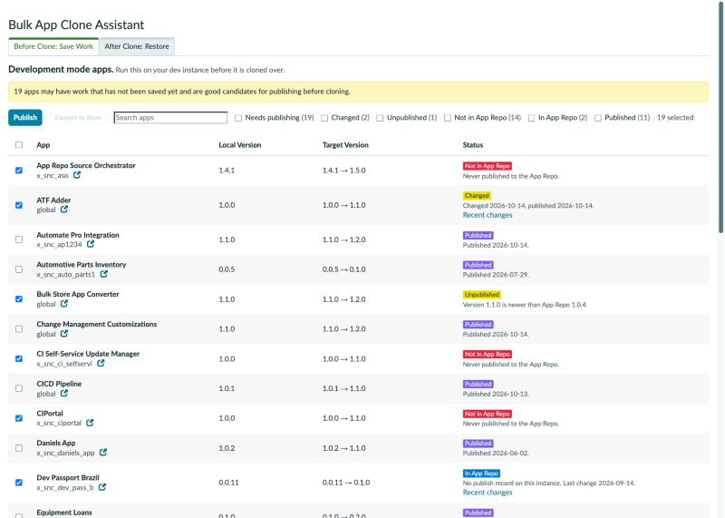

# Bulk Store App Upgrader and Converter

A global-scope ServiceNow utility that helps administrators get company apps through an instance clone. Before the clone, it publishes development mode apps to My Application Repository (App Repo) so no work is lost. After the clone, it upgrades store mode apps and converts them back to development mode.

Demo and discussion: https://sn.works/aemc/bulkupgradeconvert

## Install

Choose one option.

1. **Update set (recommended).** Download [`Bulk-Store-App-Converter-1.2.0.xml`](share/Bulk-Store-App-Converter-1.2.0.xml), the latest version. On your instance, open **Retrieved Update Sets**, import the file, then preview and commit it. Earlier versions are in the [`share`](share) folder.
2. **now-sdk.** Clone this repo, authenticate with `npx @servicenow/sdk auth`, then run `npm run build` and `npm run deploy`.

**Requirements:** the `admin` role and ServiceNow Washington DC or later.

## Use

Open **System Applications > Bulk App Clone Assistant**. The page has two tabs.

### Before Clone: Save Work

Run this on the instance you are about to clone over. The tab lists every development mode app with one status:

1. **Changed**: edited after it was published.
2. **Unpublished**: the local version is newer than the App Repo version.
3. **Not in App Repo**: never published.
4. **In App Repo**: the App Repo has this version, but no publish record exists on this instance.
5. **Published**: the App Repo has this version and nothing changed since.
6. **Check failed**: the check could not finish. Use **Retry check** or follow the error log link.

Every app that is not Published starts selected. Narrow the list with the search box, **Needs publishing**, or the status checkboxes. **Recent changes** shows what was edited locally.

1. Click **Publish**. Each selected app goes to the App Repo at the next minor version the App Repo accepts. The Target Version column shows the version it will publish.
2. When the banner reads "All dev apps are published to the App Repo. Safe to clone.", clone the instance.

**Convert to Store** converts the selected apps to store mode. It is enabled only for Published apps, and for apps whose version a conversion reset while the App Repo still has them.

The page switches the application picker per app while publishing, shows a "Scope changed to Global" notice, and returns the picker to **Global** when the run ends.

### After Clone: Restore

Run this on the cloned instance. Opening the tab refreshes My Company Applications from the App Repo so the Target Version column is current. Apps with a newer target show an **Upgrade** badge, and the **Upgrade available** checkbox filters to them.

1. **Upgrade and Convert**: upgrades each selected app, then converts it to development mode.
2. **Upgrade**: upgrades each selected app and leaves it in store mode.
3. **Convert to Dev**: converts each selected app to development mode as it is.

Apps at `0.0.0-CONVERTED` with no App Repo version are skipped by the upgrade actions. Use **Convert to Dev** for those.

**Save selection** writes the checked apps to the `bulk_convert_store_app.convertible_apps` system property (a comma-separated list of scopes, such as `x_myapp_1,x_myapp_2`). **Load saved list** checks them again, for example on a fresh clone.

## Bulk upgrade modules

Two modules under **System Applications** upgrade store apps without opening the page. Refresh **My Company Applications** afterward to see the new versions.

1. **Bulk Upgrade ALL My Company Apps** upgrades every company-owned app.
2. **Bulk Upgrade My Company Apps from Property** upgrades only the scopes in `bulk_convert_store_app.convertible_apps`.

## Contributing

Fork it and make it your own. There is no warranty. Open an issue or reach out to become a contributor.
