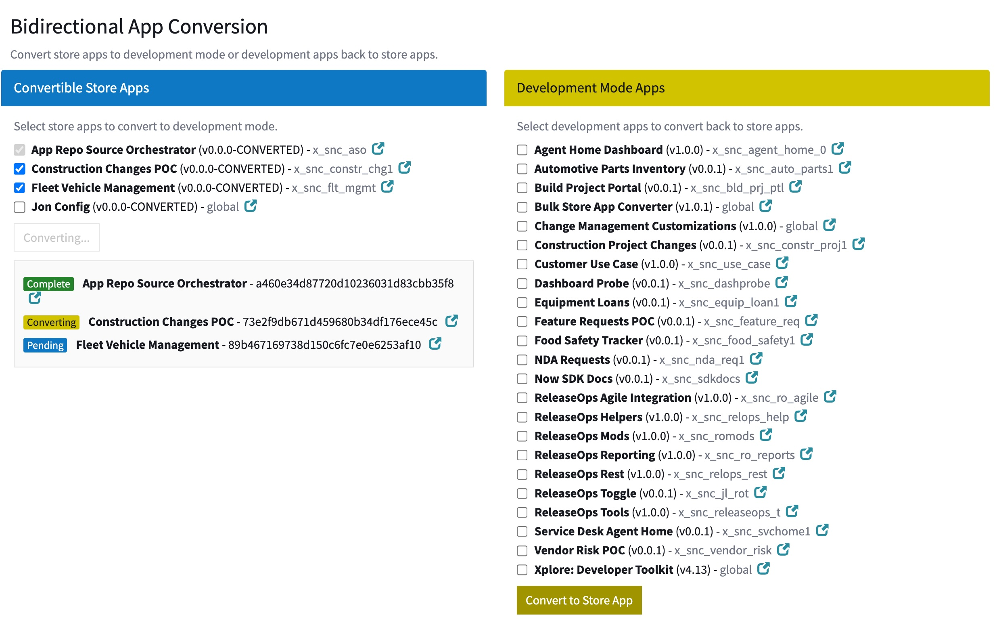

# Bulk Store App Upgrader and Converter

A global-scope ServiceNow utility for administrators to prepare company apps for an instance clone and restore them afterward. It publishes development mode apps (`sys_app`) to My Application Repository (App Repo) before a clone, then upgrades and converts apps between store mode (`sys_store_app`) and development mode (`sys_app`) after the clone.

See a demo and more information on ServiceNow Community at https://sn.works/aemc/bulkupgradeconvert



## Bulk App Clone Assistant

The page is the module **Bulk App Clone Assistant** under **System Applications**. It is limited to the `upgrade_admin` role and has two tabs.

### Before Clone

Lists every development mode app and checks it against the App Repo so that no work is lost in the clone. Each app shows one status:

1. **Changed**: the App Repo has the current version, but the app was edited after it was published.
2. **Unpublished**: the local version is newer than the App Repo version.
3. **Not in App Repo**: the app has never been published.
4. **In App Repo**: the App Repo has the current version, but no local publish record exists.
5. **Published**: the App Repo has the current version and nothing changed after it.
6. **Check failed**: the check could not finish. The row shows a verbose error, a **Retry check** link, and a link to the matching error logs.

Every app that is not Published is selected by default. Filters cover search, **Needs publishing**, and one checkbox per status. A **Recent changes** link opens the local edits behind a Changed, In App Repo, or Check failed row.

**Publish** sends each selected app to the App Repo at the next minor version the App Repo accepts. The target column shows `<current> to <next>`. After a run the list reloads and the published apps come back unchecked.

Apps converted to store mode and back carry the version `0.0.0-CONVERTED`. The page flags them and offers to convert them back to store mode so they can be upgraded.

### After Clone: Restore

Lists the apps installed in store mode. Opening the tab refreshes My Company Applications from the App Repo, so the **Target Version** column is current. Apps with a newer target version show an **Upgrade** badge.

1. **Upgrade and Convert**: upgrades each selected app, then converts it to development mode.
2. **Upgrade**: upgrades each selected app and leaves it in store mode. Apps with nothing to upgrade are skipped.
3. **Convert to Dev**: converts each selected app to development mode as it is.

Apps at `0.0.0-CONVERTED` with no App Repo version are skipped by the upgrade actions. Use **Convert to Dev** for those.

## Bulk Upgrade Modules

Two modules under **System Applications** upgrade store apps to their latest versions without opening the page. They share the same `runUpgrade` logic as the Restore tab.

1. **Bulk Upgrade ALL My Company Apps**: upgrades every company-owned app. No configuration required.
2. **Bulk Upgrade My Company Apps from Property**: upgrades only the app scopes in the `bulk_convert_store_app.convertible_apps` system property, a comma-separated list such as `x_myapp_1,x_myapp_2`.

Both modules are limited to admins. After either one runs, refresh **My Company Applications** so the new versions show.

## Requirements

1. **Role**: `admin` for the upgrade modules and `upgrade_admin` for the page.
2. **Scope**: the application picker is switched per app during a publish and returns to **Global** at the end of a run.
3. **Platform**: ServiceNow Washington DC or later.

## Post-Clone Workflow

1. Before the clone, open **Bulk App Clone Assistant** on the source instance, review the **Before Clone** tab, and publish every app that is not Published.
2. Clone the instance.
3. Log in to the cloned instance and open **Bulk App Clone Assistant**.
4. Open the **After Clone: Restore** tab and select your apps.
5. Click **Upgrade and Convert** to bring each app current and return it to development mode.

## Development

This is a now-sdk Fluent project (SDK 4.13.6).

```bash
npm run build
npm run deploy
```

## Retrieved Update Set

[`Bulk-Store-App-Converter-1.2.0.xml`](share/Bulk-Store-App-Converter-1.2.0.xml) installs the app without cloning the repo. Load it into **Retrieved Update Sets** on your instance and commit it. Earlier versions of the file stay in the [`share`](share) folder.

## Bundling and Export

1. **Fork**: fork this repo and install it into your instance directly.
2. **Copy and paste**: the main files are the script includes, the user interface (UI) page, and the modules. You can create your own files and copy the code.

## Contributions

If you fork it, they will come. Reach out to become a contributor if you plan to make changes. I would love to see what you are doing and learn from you.

## Use This as Inspiration

This is meant to be inspiration for your own solution. There is no warranty, and you are expected to support it yourself. If you have an issue, become a contributor and submit the fix, or create an issue.

Happy coding!
