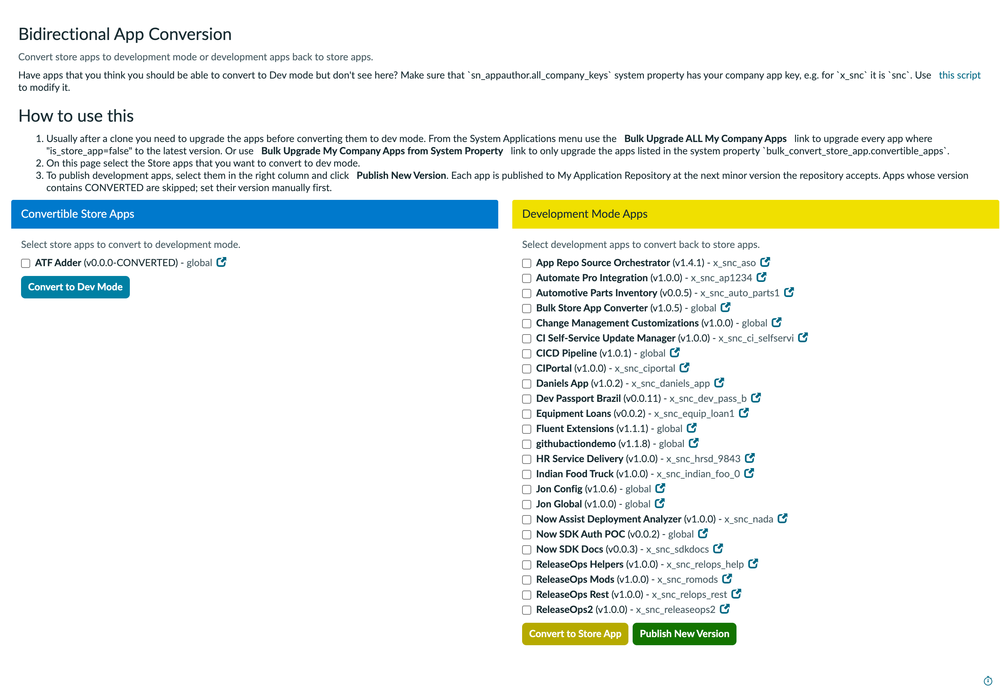

# Bulk Store App Upgrader and Converter: Feature and UX Overview

Baseline of what the app does for a user today and how each feature is reached. This is the starting point for the UI refactor, so it describes the current user experience first and the code only briefly. Captured from the live page on the xare instance (app version 1.0.5, branch `ui-refactor`, commit b37c600). Screenshots are in `docs/screenshots/`.

## 1. Features

The app serves an administrator who has cloned an instance and needs company-owned apps back in a working state. It offers five features, reached from two places: two menu modules and one page.

| # | Feature | Reached from | Works on |
|---|---------|--------------|----------|
| 1.1a | Bulk upgrade, all company apps | System Applications menu | Store apps (`sys_store_app`) |
| 1.1b | Bulk upgrade, apps listed in a system property | System Applications menu | Store apps (`sys_store_app`) |
| 1.2 | Convert store apps to development mode | Converter page, left panel | Store apps |
| 1.3 | Convert development apps back to store apps | Converter page, right panel | Development apps (`sys_app`) |
| 1.4 | Publish new version to My Application Repository (App Repo) | Converter page, right panel | Development apps |

### 1.1 Bulk upgrade: two ways to run it

Both ways install the latest available version of store apps in one batch. They differ only in which apps they pick up. Each is a menu module under **System Applications**, configured to ask for confirmation and then run a one-line script.

**1.1a Bulk Upgrade ALL My Company Apps**

1. Upgrades every store app where `is_store_app=false` (apps the company owns, as opposed to ServiceNow or third-party apps).
2. Needs no configuration.
3. Use it when everything company-owned should be brought current.

**1.1b Bulk Upgrade My Company Apps from Property**

1. Upgrades only the app scopes listed in the system property `bulk_convert_store_app.convertible_apps`, a comma separated list such as `x_snc_auto_parts1,x_snc_equip_loan1`.
2. Stops with an error when the property is empty.
3. Use it when a specific, known set of apps should be upgraded on every clone. The list can be maintained once in production so it carries across clones.
4. The shipped default has a space before the last scope, which may stop that scope from matching.

**What the user experiences for both (from the module configuration and script)**

1. Click the menu item, confirm the prompt.
2. The upgrade starts a batch install in the background. There is no page, progress bar, or result summary in the module.
3. Results exist only in the system log: how many candidates were found, each candidate (`name scope version -> latest`), and links to the batch install plan record and the execution tracker. The batch install plan gets a note saying that apps populate over time and the state moves to In progress and then Installed.
4. If nothing needs upgrading, the only signal is a log message.
5. The user must refresh My Company Applications beforehand or the script may see no available upgrades.
6. Apps with an empty `latest_version` or a version already at or above latest are skipped.
7. Neither module checks a role. The menu itself is the only gate.

### 1.2 Convert store apps to development mode (left panel)

1. The left panel, **Convertible Store Apps**, lists store apps the platform says can be converted (`canConvertSysStoreApp`). Each row shows name, version, scope, and an icon that opens the record in a new tab.
2. The user checks any number of apps and clicks **Convert to Dev Mode**.
3. The apps convert one at a time. A status area under the button shows one row per app: `Pending`, then `Converting`, then `Complete` or `Failed`.
4. A finished app has its checkbox checked and disabled. The button changes to "Done" and a message says to refresh the page.
5. The lists do not update until the user reloads. A converted app keeps showing in its original panel until then.

### 1.3 Convert development apps back to store apps (right panel)

1. The right panel, **Development Mode Apps**, lists development apps the platform says can be converted (`canConvertSysApp`). The list on xare has 24 apps, including global apps such as this converter itself.
2. The user checks apps and clicks **Convert to Store App**.
3. Behavior matches 1.2: one at a time, `Pending`, `Converting`, `Complete` or `Failed`, then a manual refresh.
4. Converted apps get the version `0.0.0-CONVERTED`. Upgrading the store app from App Repo restores the real version. An app that was never published to App Repo cannot be restored this way; its version must be set by hand.

### 1.4 Publish new version (right panel)

1. The user checks development apps and clicks **Publish New Version** (green button next to Convert to Store App).
2. Apps whose version contains `CONVERTED` are skipped. An alert lists them and each gets a grey `Skipped` row. The user must set a version by hand first.
3. For each remaining app, one at a time, the page:
   1. Switches the user's application picker to that app (a side effect the user does not see).
   2. Finds the next minor version that App Repo accepts (for example 1.2.5 becomes 1.3.0), trying up to 3 times.
   3. Starts the stock upload and shows `Pending`, `Publishing`, then `Published` with a note "Published vX (was vY)", or `Failed`.
4. A failure shows a red message at the top naming the app, the version on the record, and the last version attempted.
5. At the end the picker returns to Global, the button reads "Done", and a message says to refresh.
6. The right-hand status area is shared with Convert to Store App.

### 1.5 Conditions and warnings the page shows

1. The page renders only for users with the `admin` role.
2. All three page buttons are disabled (grey, unclickable) when the application picker is not Global, with a red platform message at the top. Nothing on the page itself explains how to switch.
3. A paragraph explains that apps may be missing from the left list when `sn_appauthor.all_company_keys` lacks the company key (for example `snc` for `x_snc`), and links a community script. The page cannot detect or fix this. On xare the property is empty, so Jon AI, NDA Requests and Peugeot are missing from the left list after conversion. Only ATF Adder (version `0.0.0-CONVERTED`) shows there.

## 2. Current UX walkthrough

Screenshot 2 (`screenshots/02-converter-page-viewport.png`) shows the first screen without scrolling.

1. The first screen is mostly text: a title, a subtitle, the `all_company_keys` paragraph, and a three-step "How to use this" list. The panels start below that, and the lower half of a long development list is below the fold.
2. The how-to list tells the user to open the menu for upgrades, then use the page for conversion and publishing. Upgrade and the page are separate trips with no link between them.
3. The how-to list does not mention Convert to Store App or what the status labels mean. It still names the second module "Bulk Upgrade My Company Apps from System Property" while the menu says "...from Property".
4. Each panel is a flat checkbox list, alphabetical by name. There is no search, filter, sort, select all, or count of selected apps. The left list can be a single row; the right list is 24.
5. Buttons sit at the bottom of each list, below all rows, so a long list pushes them off screen.
6. Progress and results appear in a small scrolling box under the buttons (200 pixels high) with colored labels. Colors: Pending light blue, Converting and Publishing orange, Complete green, Published blue, Failed red, Skipped grey. Complete (conversion) and Published (publish) are green and blue so the two outcomes can be told apart.
7. After any action the page is stale and the user has to reload to see apps move between panels or new versions appear.
8. Upgrade gives no on-screen feedback at all. The user has to go to the system log and the batch install plan.
9. Failures show in two places: a label on the row and a red banner at the top of the page. The banners accumulate and are never cleared.
10. Browser alert dialogs are used for "nothing selected" and for the CONVERTED skip list. These are the only modal pop-ups.
11. The app lists itself and other global apps as convertible and publishable. Nothing marks apps by scope type, source, or readiness.
12. Server work runs one app at a time with a poll every 3 seconds, so a large batch is slow. The user can navigate away mid-run, which stops the queue.

## 3. Where the code lives

For detail, read the source. Paths under `src/fluent/`.

| Piece | File |
|-------|------|
| Converter page (markup and all client script) | `ui-pages/bulk_convert_store_app_confirm.now.ts` |
| Upgrade logic (called by the two upgrade modules) | `script-includes/BulkUpgradeMyCompanyApps.server.js` |
| Next-version lookup (called by the Publish button) | `script-includes/BulkPublishMyCompanyApps.server.js` |
| Menu modules | `modules/bulk-convert-my-company-apps.now.ts`, `modules/bulk-upgrade-all-my-company-apps.now.ts`, `modules/bulk-upgrade-my-company-apps-from-property.now.ts` |
| System property | `properties/bulk_convert_store_app.convertible_apps.now.ts` |

Platform APIs the features rely on: `com.snc.apps.AppsAjaxProcessor` (conversion, picker switch), `sn_appauthor.ScopedAppUploaderAJAX` (publish), `sn_appauthor.ScopedAppVendorInfoObtainer` (version check), `sn_appclient.AppUpgrader` (batch upgrade), and the `sys_execution_tracker` table (progress polling).

## 4. Documentation gaps to fix in README

1. README says the role requirement is `admin`; the two upgrade modules have no role.
2. The README screenshot (`bulk-store-app-converter.jpg`) predates the Publish New Version button.
3. README does not say that upgrade results appear only in the system log.
4. The property description says "to convert to development mode" but the property only drives upgrades (1.1b).
5. The README platform claim "Washington DC+" has not been verified.
